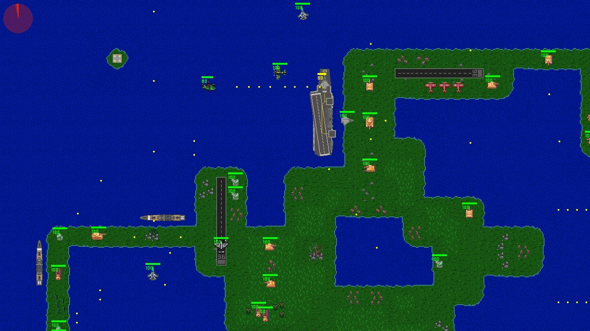
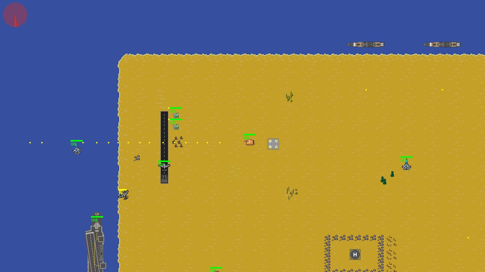
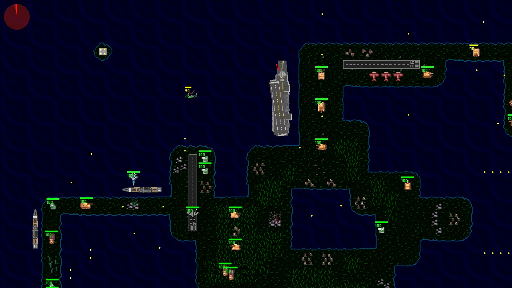

# game_engine_2d

Simple 2D Game Engine (+ game) written in C++, based on the course from: `https://courses.pikuma.com/courses/take/2dgameengine`

Tech stack:

- SDL 2.32.10 (extensions SDL_image, SDL_mixer, SDL_ttf)
- GLM 1.0.3
- ImGui 1.93.0 (SDL2 backend)
- Lua 5.4.8
- Sol 3.5.0

Controls:

- ARROWS / WASD - movement
- SPACE - shooting
- ESC - quit

A random level out of 3 is loaded at game start

